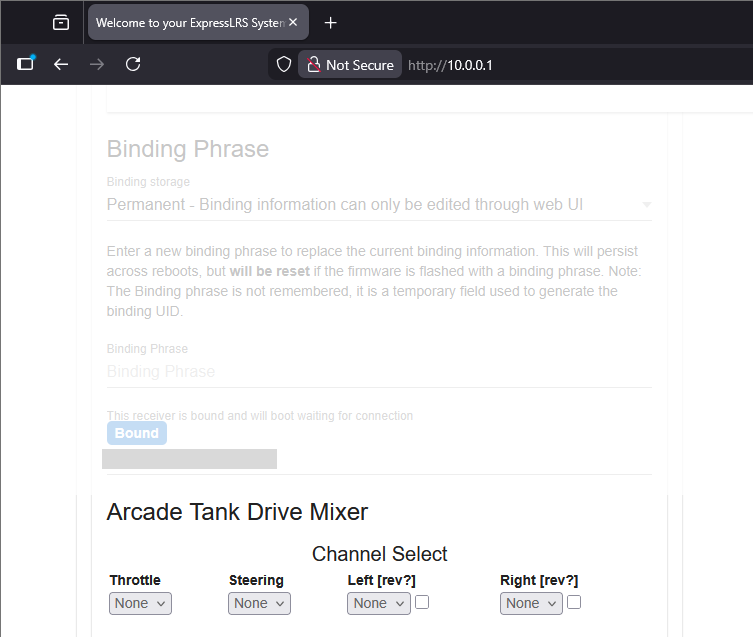
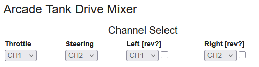

I built these firmware files because the community was asking for the receiver channel mixer feature.

They are based on commit `81313e1b4d2ae3a511cda2a5e1f83e7d74cf4938`.

How To Use The Mixer
====================

First, access the ELRS Wi-Fi interface. I am assuming you already know how to do this.

Scroll down until you see the "Arcade Tank Drive Mixer" section.

Use the drop-down menus, "Throttle" and "Steering" selects the input channels. "Left" and "Right" selects the output channels.

The "[rev?]" checkbox will reverse the corresponding output channel.

That is all the features implemented right now, there's no individual channel offsetting or scaling right now. I can work on this if it is required.
